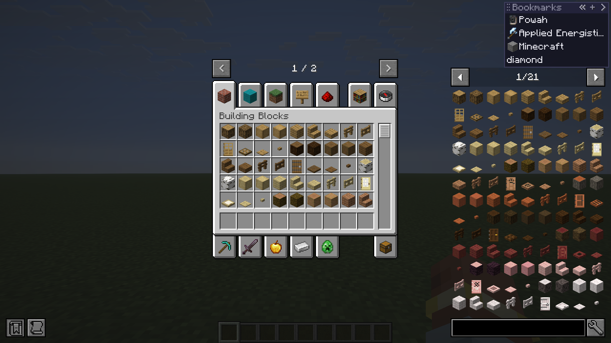
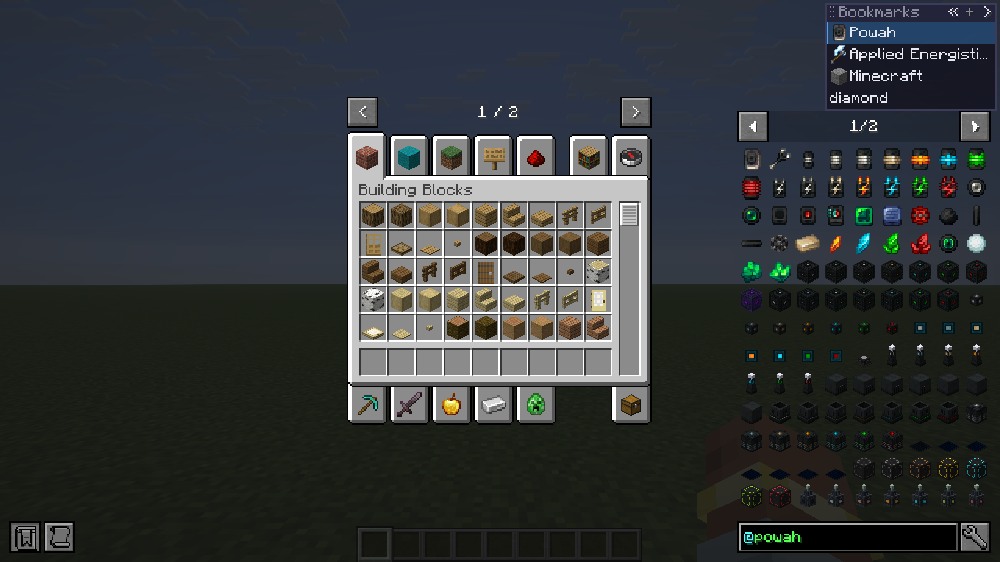
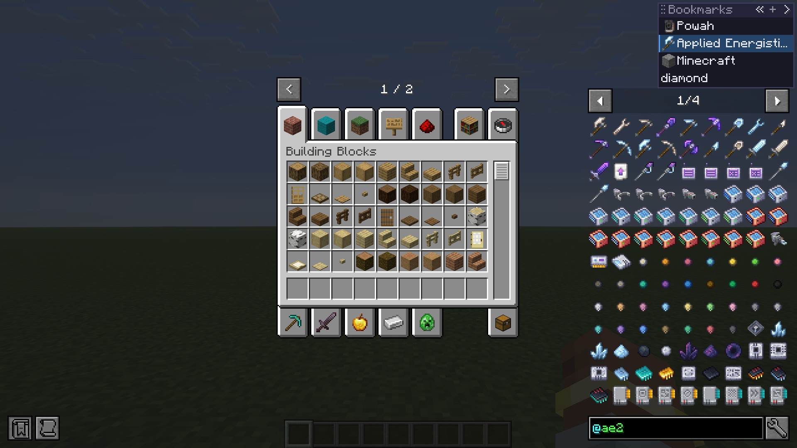

# SyntexJeiBookmarks

Search bookmarks for JEI. Save searches like `@powah`, click one, and the JEI list filters to it.

Client-side mod for Minecraft 26.1 and 1.21.1 (NeoForge) and 1.20.1 (Forge). Requires [JEI](https://modrinth.com/mod/jei), not needed on the server.

This was actually meant to be a private mod just for me, but why should I be the only one who gets to use it?

Built with AI help (vibecoded with Claude Code) and tested in a real Minecraft client.

## Download

- [CurseForge](https://www.curseforge.com/minecraft/mc-mods/syntexjeibookmarks)
- [GitHub Releases](https://github.com/SyntexGaming/SyntexJeiBookmarks/releases)

| Minecraft | Loader | Branch |
| --- | --- | --- |
| 26.1.2 | NeoForge | `main` |
| 1.21.1 | NeoForge | `1.21.1` |
| 1.20.1 | Forge | `1.20.1` |

## Screenshots

## How to use

- `+` in the panel header saves the current text of the JEI search bar
- `M` over any item saves its mod as `@modid` (rebindable in the controls menu)
- Left click on a bookmark searches for it, a second click clears the search
- Right click removes a bookmark
- Drag the handle `⋮⋮` to move the panel, `<` / `>` collapse it, `«` / `»` snap it to the left or right edge

Bookmarks and panel position are saved per instance in `config/syntexjeibookmarks.json`.

## Building

Put the JEI jar into `libs/` (file name in `libs/README.txt`), then run `gradlew build` with JDK 25 (branch `main`, 26.1), JDK 21 (branch `1.21.1`) or JDK 21 with the JDK 17 toolchain (branch `1.20.1`, Forge).

## License

MIT, see `LICENSE`.

---

## Deutsch

Such-Lesezeichen für JEI. Speichere Suchen wie `@powah`, klick darauf, und die JEI-Liste filtert danach. Reiner Client-Mod, JEI wird benötigt.

Eigentlich war das ein privater Mod nur für mich, aber warum sollte ich der Einzige sein, der ihn nutzen kann?

Mit KI-Hilfe gebaut (vibecoded mit Claude Code) und in einem echten Minecraft-Client getestet.

Bedienung: `+` speichert die aktuelle Suche, Taste `M` über einem Item speichert dessen Mod, Linksklick sucht (zweiter Klick leert), Rechtsklick entfernt, das Panel lässt sich am Griff `⋮⋮` verschieben.
